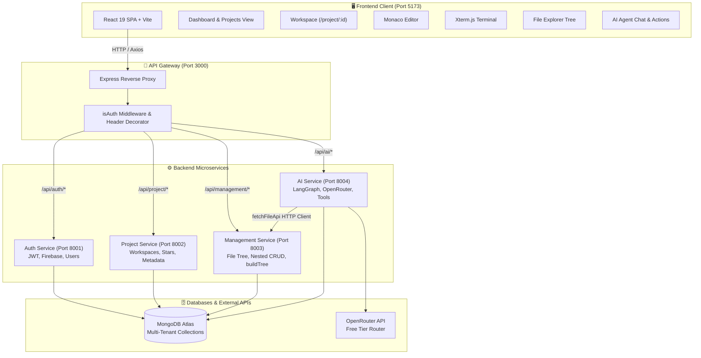

# ⚡ BHASHA AI-IDE — Cloud-Native AI Pair Programming Workspace

<div align="center">


<p align="center">
  <b>A modern, distributed, microservice-powered cloud IDE featuring an embedded Monaco editor, interactive virtual terminal, recursive filesystem hierarchy, and an autonomous LangGraph AI pair-programmer agent.</b>
</p>

[Key Features](#-key-features) •
[Architecture](#-system-architecture) •
[Tech Stack](#-technologies--labels) •
[Microservices Breakdown](#-microservices-deep-dive) •
[Frontend Experience](#-frontend-workspace-experience) •
[AI Agent Tools](#-autonomous-ai-agent--langgraph-tools) •
[API Reference](#-api-endpoints-reference) •
[Getting Started](#-getting-started) •
[Environment Variables](#-environment-configuration)

---

</div>

## 📌 Project Overview

**BHASHA AI-IDE** is an end-to-end cloud development environment designed to provide developers with a lightweight, browser-based coding platform coupled with an agentic AI pair programmer. Rather than a monolithic backend, the platform is architected as decoupled microservices routed through a high-performance Express reverse proxy API Gateway, backed by MongoDB Atlas, LangGraph, and OpenRouter LLMs.

---

## 🌟 Key Features

- 🖥️ **Full-Fledged In-Browser IDE**: Built on Monaco Editor (the editor powering VS Code) with multi-tab management, syntax highlighting, breadcrumb pathing, and live status bar telemetry.
- 🗂️ **Hierarchical Virtual Filesystem**: Self-referencing Mongoose schema supporting deeply nested directories, recursive soft deletes, and alphabetical directory tree synthesis (`buildTree`).
- 🎨 **Extension-Accurate Brand Icons**: Custom file icon engine rendering brand-authentic logos and palettes (`.jsx` React Cyan, `.js` JS Yellow, `.ts` TS Blue, `.html` Orange, `.css` Blue, `.json` Amber, `.py` Python Blue, etc.).
- 💻 **Integrated Virtual Terminal**: Built with `@xterm/xterm` and `@xterm/addon-fit`, equipped with ANSI color schemes, key event bindings, and simulated interactive commands (`npm run dev`, `ls`, `clear`, `help`).
- 🤖 **Autonomous AI Agent**: LangGraph-driven state machine running on OpenRouter with strict token & cost guards, streaming tool executions via Server-Sent Events (SSE) to autonomously inspect the file tree, read files, generate code, update existing files, and build folder structures.
- ⚡ **Built-In Live Preview (`Code | Split | Preview`)**: In-browser sandbox supporting both **React + Vite** (`@babel/standalone` + `esm.sh` + Tailwind CSS) and **HTML + CSS + JavaScript** apps, complete with viewport toggles, sandbox storage shims, and runtime error reporting.
- 🛡️ **Zero-Cost LLM Budget Guarding**: Hardened configuration featuring token caps (`MAX_TOKENS`), low deterministic temperature (`0.1`), retry elimination (`maxRetries: 0`), timeout cutoffs, and strict `$0` price ceilings (`max_price: { prompt: 0, completion: 0 }`) loaded cleanly from `.env`.
- 🔐 **Microservice Security & Auth**: Reverse-proxied sessions, cookie management, JWT authentication, and user header decoration (`x-user-id`, `x-user-email`) protecting microservices.
- 🎨 **Futuristic Design System**: Minimalist slate and dark-mode aesthetic built with Tailwind CSS v4, smooth spring animations via Framer Motion, and responsive panel toggling.

---

## 🏗️ System Architecture



---

## 🏷️ Technologies & Labels

### Frontend
| Technology | Badge | Description |
| :--- | :--- | :--- |
| **React 19** |  | Next-generation React core with modern hooks and fast rendering |
| **Vite 8** |  | Lightning-fast development server and optimized Rolldown/ESM bundler |
| **Tailwind CSS v4** |  | Modern utility-first CSS engine using native CSS `@import` |
| **Monaco Editor** |  | Full-featured code editor engine with dark theme and syntax highlighting |
| **Xterm.js** |  | Browser-based terminal emulator component with `@xterm/addon-fit` |
| **Redux Toolkit** |  | Global state management for authentication and session persistence |
| **React Router** |  | Client-side routing for `/login`, `/home`, and `/project/:id` |
| **Framer Motion** |  | Declarative layout animations, modals, and tab transitions |
| **React Icons** |  | Comprehensive icon packs (VS Code `vsc`, Simple Icons `si`, Feather `fi`) |

### Backend & AI Infrastructure
| Technology | Badge | Description |
| :--- | :--- | :--- |
| **Node.js** |  | Modern JavaScript runtime supporting ES Modules |
| **Express.js v5** |  | Scalable HTTP microservices and routing framework |
| **Express HTTP Proxy** |  | High-performance reverse proxy for API Gateway routing |
| **MongoDB Atlas** |  | Multi-cluster cloud NoSQL database with Mongoose ODM |
| **LangChain Core** |  | Modular framework for building LLM agents and tool calling |
| **LangGraph** |  | State graph orchestration for multi-step AI reasoning loops |
| **OpenRouter** |  | Unified LLM routing provider configured via environment variables |
| **Zod** |  | Strict runtime schema validation for AI agent tool inputs |
| **JWT** |  | Secure token authentication across cookies and internal microservices |
| **Firebase Admin** |  | Authentication verification and social Google OAuth login |

---

## 🧩 Microservices Deep Dive

```
backend/
├── gateway/              # Reverse Proxy API Gateway (Port 3000)
└── services/
    ├── auth/             # Authentication & User Management (Port 8001)
    ├── project/          # Project Workspaces & Metadata (Port 8002)
    ├── management/       # Virtual Filesystem & Directory Trees (Port 8003)
    └── AI/               # LangGraph Autonomous Agent & LLM Tools (Port 8004)
```

### 1. API Gateway (`backend/gateway`)
The central ingress controller for the entire architecture.
- **Port**: `3000`
- **Responsibilities**:
  - Handles Cross-Origin Resource Sharing (CORS) with `credentials: true`.
  - Cookie parsing and request access logging (`morgan`).
  - Enforces `isAuth` verification on protected routes.
  - Decorates requests heading to internal services with identity headers:
    - `x-user-id`: MongoDB user ID
    - `x-user-email`: Authenticated user email
  - Routes traffic seamlessly to underlying microservices:
    - `/api/auth` ➔ `AUTH_SERVICE` (8001)
    - `/api/project` ➔ `PROJECT_SERVICE` (8002)
    - `/api/management` ➔ `MANAGEMENT_SERVICE` (8003)

### 2. Management Microservice (`backend/services/management`)
Responsible for modeling, storing, and organizing nested project filesystems.
- **Port**: `8003`
- **Database Model (`File` Schema)**:
  - `owner`: Reference to User.
  - `projectId`: Reference to Project.
  - `parentId`: Self-reference to `File._id` (`null` for workspace root).
  - `name`: Clean filename or folder name.
  - `type`: Enum `['file', 'folder']`.
  - `content`: Full string code content.
  - `language`: Code language identifier (e.g. `javascript`, `css`).
  - `extension`: Computed extension (e.g. `jsx`, `json`).
  - `size`: Byte length of content.
  - `isDeleted`: Soft-delete flag (preserves project history).
  - **Compound Unique Index**: `(projectId, parentId, name, isDeleted)` preventing duplicate filenames inside the same folder.
- **`buildTree` Algorithm**:
  - Transforms flat MongoDB query results into a recursive directory tree in $O(N)$ time using map indexing.
  - Automatically sorts folders before files alphabetically.
- **Cascade Deletion**:
  - `deleteFolder` iteratively resolves all nested child folder and file IDs across arbitrary tree depths and soft-deletes the entire sub-tree atomically.

### 3. AI Agent Microservice (`backend/services/AI`)
Responsible for intelligent pair-programming, automated workspace scaffolding, and code editing over real-time SSE streaming.
- **Port**: `8004`
- **Engine**: LangGraph state machine powered by `@langchain/openrouter` with safe `ToolMessage`-aware context window trimming (`maxMessage = 30`).
- **Models Configured (via `.env` `OPENROUTER_MODEL` & `OPENROUTER_FALLBACK_MODELS`)**:
  1. **`cohere/north-mini-code:free`** *(Primary)* — Coding-specialized free model (`256k` context, `tools` / `tool_choice` support) delivering fast, accurate filesystem tool calls.
  2. **`nvidia/nemotron-3-ultra-550b-a55b:free`** *(Fallback 1)* — High-capacity 550B MoE free model (`1M` context, `tools` support) used as backup for complex multi-file reasoning.
  3. **`openrouter/free`** *(Fallback 2)* — OpenRouter's official `$0.00` auto-router (`200k` context) that dynamically selects active tool-capable free models if individual promotional slugs rotate.
- **Guardrails (`llm.js` & `ai.controllers.js`)**:
  - Zero hardcoded model strings in source code (loaded strictly from `.env`).
  - Strict low temperature (`0.1`) eliminating token waste and hallucination.
  - Configurable max token ceiling (`MAX_TOKENS=4096`) to prevent mid-file JSON tool truncation.
  - Hard zero-cost price limit (`max_price: { prompt: 0, completion: 0 }`) with 3-model OpenRouter cap.
  - Timeout cutoff (`60000ms`), `maxRetries: 0`, and friendly `429` quota/reset error formatting.
- **Internal API Client (`fetchFileApi.js`)**:
  - Provides reliable inter-service HTTP communication directly to the Management Service with `x-user-id` forwarding.

---

## 💻 Frontend Workspace Experience

Located at [`frontend/`](file:///c:/Users/263237/Desktop/MERN/AI-Editor/frontend), the web interface offers a high-performance, responsive desktop IDE experience.

### 1. Dashboard & Project Management (`/home`)
- **Projects Grid**: Displays workspace cards with dynamic status dots, project tags, and timestamp indicators (`timeAgo`).
- **Starring & Filtering**: 1-click star/unstar action with dynamic counter badges (`Starred (N)` vs `Projects (N)`).
- **Search & Keyboard Shortcuts**: Instant search filter with `⌘K` / `Ctrl+K` keyboard listener.
- **Modals**: Smooth Framer Motion dialogs for New Project Creation and Delete Confirmation.

### 2. Main IDE Workspace (`/project/:id`)
- **Activity Bar**: Slim VS Code-style vertical rail providing one-click access to Explorer, Search, Source Control, AI Agent, and Settings.
- **File Explorer (`FileExplorer.jsx`)**:
  - Nested folder tree with recursive expansion and collapse.
  - Header actions: *New File*, *New Folder*, *Refresh*, *Collapse All*.
  - Inline input creation with blur and keyboard submit.
- **Extension-Accurate Brand Icons (`fileIcons.jsx`)**:
  - Dynamically extracts extensions and renders authentic brand SVG icons:
    - ⚛️ `.jsx` ➔ React Atom Cyan (`#61DAFB`)
    - 🟨 `.js`, `.mjs` ➔ JavaScript Yellow (`#F7DF1E`)
    - 🟦 `.ts` ➔ TypeScript Navy (`#3178C6`)
    - ⚛️ `.tsx` ➔ TypeScript React Sky Blue (`#38BDF8`)
    - 🟧 `.html` ➔ HTML5 Orange (`#E34F26`)
    - 🎨 `.css` ➔ CSS3 Royal Blue (`#2563EB`)
    - 📦 `.json` ➔ JSON Warm Amber (`#F59E0B`)
    - 📝 `.md` ➔ Markdown Sky Blue (`#38BDF8`)
    - 🐍 `.py` ➔ Python Blue (`#3776AB`)
    - 🦀 `.rs` ➔ Rust Terracotta (`#DEA584`)
    - 🔒 `.env*` ➔ Secure Key Lock (`#FACC15`)
    - 🖼️ `.png`, `.jpg` ➔ Media Emerald (`#34D399`)
- **Monaco Code Editor (`CodeEditor.jsx`)**:
  - Integrated via `@monaco-editor/react`.
  - Multi-file tab bar with active tab indicators and close triggers (`×`).
  - Custom dark theme matching `#07090e` workspace aesthetic.
  - Breadcrumbs path tracker (`src > App.jsx`) with live saved status.
  - Live cursor tracking in footer (`Ln 14, Col 22`, `UTF-8`, `Spaces: 2`).
- **Interactive Terminal Dock (`TerminalPanel.jsx`)**:
  - Powered by `@xterm/xterm` and `@xterm/addon-fit`.
  - Dock tabs: `TERMINAL`, `OUTPUT`, `PROBLEMS (0)`, `DEBUG CONSOLE`.
  - Simulated interactive CLI responding to keyboard input (`dev@ai-ide:~/workspace$ `) with commands like `npm run dev`, `ls`, `clear`, and `help`.
  - Panel controls: Clear screen, Maximize/Restore dock height, and Close.
- **AI Agent Panel (`AIAgentPanel.jsx` & `features/ai.js`)**:
  - Real-time AI copilot sidebar streaming tool actions via Server-Sent Events (`fetch` + `ReadableStream`).
  - Live step-by-step tool activity cards with clickable file badges that open created/updated files directly in Monaco.
  - Instant workspace synchronization (`handleAIFileMutated`) updating the tree, open tabs, and live preview automatically, with abort/stop support (`AbortController`).
- **Live Browser Preview (`PreviewPanel.jsx` & `utils/previewBuilder.js`)**:
  - `Code | Split | Preview` view modes with Desktop/Tablet/Mobile viewport switching, manual reload, and open-in-new-tab.
  - Compiles **React + Vite** projects in-browser via `@babel/standalone`, `esm.sh`, and Tailwind CSS auto-detection, and bundles **Plain HTML + CSS + JavaScript** apps with inline stylesheet/script resolution and an in-memory `localStorage`/`sessionStorage` sandbox shim.
  - Shows `"Can't preview this project"` cleanly for non-browser technologies (e.g., Node.js backends, Python scripts).

---

## 🤖 Autonomous AI Agent & LangGraph Tools

The AI Agent in [`backend/services/AI/graph/tools.js`](file:///c:/Users/263237/Desktop/MERN/AI-Editor/backend/services/AI/graph/tools.js) is equipped with a deterministic tool suite designed for real filesystem operations:

| Tool Name | Parameters | Purpose | Strict Rules |
| :--- | :--- | :--- | :--- |
| **`get_tree`** | `{}` | Retrieves complete project folder & file hierarchy. | Call when workspace structure is unknown. Do not call repeatedly. |
| **`get_file`** | `{ fileId }` | Fetches full code content and metadata of a file. | `fileId` must belong to a file (`type="file"`). Never pass a folder ID. |
| **`create_folder`** | `{ name, parentId }` | Creates a new subdirectory under an existing folder. | `parentId` must be a folder ID (or root folder ID). Never use a file as parent. |
| **`create_file`** | `{ name, parentId, content, language }` | Generates a new file with full initial code. | `name` must include extension. Provide complete working code in `content`. |
| **`update_file`** | `{ fileId, content, name, language }` | Overwrites content, renames file, or updates language. | Always inspect with `get_file` first. Provide complete updated code (no partial diffs). |
| **`delete_file`** | `{ fileId }` | Soft-deletes a specific file from the project. | `fileId` must belong to a file. Never pass a folder ID. |

---

## 📡 API Endpoints Reference

### Management Service (`/api/management/*`)
| Method | Endpoint | Description | Request Body / Params |
| :--- | :--- | :--- | :--- |
| `POST` | `/createRootFolder` | Creates root workspace directory | `{ projectId, projectName }` |
| `POST` | `/createFolder` | Creates child folder | `{ projectId, parentId, name }` |
| `POST` | `/createFile` | Creates new code file | `{ projectId, parentId, name, content, language }` |
| `PUT` | `/updateFile/:id` | Updates file content or renames | `{ name?, content?, language? }` |
| `DELETE` | `/deleteFile/:id` | Soft-deletes a single file | URL param: `id` |
| `DELETE` | `/deleteFolder/:id` | Recursively soft-deletes directory & sub-tree | URL param: `id` |
| `GET` | `/file/:id` | Gets file content and metadata | URL param: `id` |
| `GET` | `/tree/:projectId` | Builds nested directory tree hierarchy | URL param: `projectId` |

### Project Service (`/api/project/*`)
| Method | Endpoint | Description |
| :--- | :--- | :--- |
| `POST` | `/create` | Create a new project workspace |
| `GET` | `/all` | Fetch all projects belonging to the authenticated user |
| `PUT` | `/like/:id` | Toggle star/favorite status on a project |
| `DELETE` | `/delete/:id` | Delete a project and its workspace data |

---

## 🚀 Getting Started

### Prerequisites
- **Node.js**: `v20.x` or `v22.x` installed
- **npm**: `v10.x` or higher
- **MongoDB Atlas**: Active cluster connection string
- **OpenRouter API Key**: For AI Agent service (free tier available at [openrouter.ai](https://openrouter.ai))

### 1. Clone the Repository
```bash
git clone https://github.com/KRISHNA-0425/Ai-IDE.git
cd Ai-IDE
```

### 2. Install Dependencies
Install dependencies across the gateway, services, and frontend:

```bash
# Frontend
cd frontend
npm install
cd ..

# Gateway
cd backend/gateway
npm install
cd ../..

# Auth Service
cd backend/services/auth
npm install
cd ../../..

# Project Service
cd backend/services/project
npm install
cd ../../..

# Management Service
cd backend/services/management
npm install
cd ../../..

# AI Service
cd backend/services/AI
npm install
cd ../../..
```

---

## ⚙️ Environment Configuration

Create `.env` files in their respective folders:

### `backend/gateway/.env`
```env
PORT=3000
FRONTEND_URL=http://localhost:5173
AUTH_SERVICE=http://localhost:8001
PROJECT_SERVICE=http://localhost:8002
MANAGEMENT_SERVICE=http://localhost:8003
AI_SERVICE=http://localhost:8004
JWT_SECRET=your_super_secret_jwt_key
```

### `backend/services/auth/.env`
```env
PORT=8001
MONGO_URI=mongodb+srv://<user>:<password>@cluster.mongodb.net/auth
JWT_SECRET=your_super_secret_jwt_key
```

### `backend/services/project/.env`
```env
PORT=8002
MONGO_URI=mongodb+srv://<user>:<password>@cluster.mongodb.net/project
```

### `backend/services/management/.env`
```env
PORT=8003
MONGO_URI=mongodb+srv://<user>:<password>@cluster.mongodb.net/management
```

### `backend/services/AI/.env`
```env
PORT=8004
MONGO_URL=mongodb+srv://<user>:<password>@cluster.mongodb.net/ai
MANAGMENT_SERVICE_URL=http://localhost:8003
OPENROUTER_API_KEY=sk-or-v1-your-openrouter-key
OPENROUTER_MODEL=cohere/north-mini-code:free
OPENROUTER_FALLBACK_MODELS=cohere/north-mini-code:free,nvidia/nemotron-3-ultra-550b-a55b:free,openrouter/free
MAX_TOKENS=4096
```

---

## 🏃 Running the Services

Open terminal instances for the microservices and client:

```bash
# Terminal 1: API Gateway
cd backend/gateway && npm run dev

# Terminal 2: Auth Service
cd backend/services/auth && npm run dev

# Terminal 3: Project Service
cd backend/services/project && npm run dev

# Terminal 4: Management Service
cd backend/services/management && npm run dev

# Terminal 5: AI Agent Service
cd backend/services/AI && npm run dev

# Terminal 6: Frontend Client
cd frontend && npm run dev
```

Visit **`http://localhost:5173`** in your browser to launch the application.

---

## 📂 Repository Directory Tree

```
AI-Editor/
├── backend/
│   ├── gateway/                  # Ingress API Gateway (Port 3000)
│   │   ├── index.js              # Reverse proxy routes & middlewares
│   │   └── package.json
│   └── services/
│       ├── auth/                 # Auth microservice (Port 8001)
│       │   ├── controllers/
│       │   ├── models/
│       │   └── index.js
│       ├── project/              # Project microservice (Port 8002)
│       │   ├── controllers/
│       │   ├── models/
│       │   └── index.js
│       ├── management/           # Filesystem microservice (Port 8003)
│       │   ├── controllers/      # File & folder CRUD, tree controllers
│       │   ├── models/           # File schema with parentId hierarchy
│       │   ├── routes/           # Management Express routes
│       │   ├── utils/            # buildTree recursive tree builder
│       │   └── index.js
│       └── AI/                   # AI Agent microservice (Port 8004)
│           ├── controllers/
│           │   └── ai.controllers.js # SSE stream handler & history builder
│           ├── graph/
│           │   ├── graph.js      # LangGraph state machine & system prompt
│           │   └── tools.js      # LangChain filesystem tool suite
│           ├── routes/           # AI Express routes
│           ├── utils/
│           │   ├── fetchFileApi.js # Inter-service HTTP management client
│           │   └── llm.js        # Hardened OpenRouter LLM client
│           └── index.js
├── frontend/                     # React 19 + Vite SPA (Port 5173)
│   ├── src/
│   │   ├── components/
│   │   │   ├── editor/
│   │   │   │   ├── AIAgentPanel.jsx   # Autonomous AI agent sidebar (SSE)
│   │   │   │   ├── CodeEditor.jsx     # Monaco editor canvas & tabs
│   │   │   │   ├── FileExplorer.jsx   # Nested directory tree & actions
│   │   │   │   ├── PreviewPanel.jsx   # In-browser React & HTML live preview
│   │   │   │   └── TerminalPanel.jsx  # Interactive Xterm.js terminal
│   │   │   ├── DeleteConfirmationModal.jsx
│   │   │   ├── EmptyState.jsx
│   │   │   ├── NewProjectModal.jsx
│   │   │   ├── ProjectCard.jsx
│   │   │   ├── Sidebar.jsx
│   │   │   └── TopBar.jsx
│   │   ├── features/
│   │   │   ├── ai.js             # SSE fetch reader for AI Agent
│   │   │   ├── management.js     # Management CRUD & tree API client
│   │   │   └── project.js        # Project CRUD API client
│   │   ├── pages/
│   │   │   ├── Homepage.jsx      # Projects dashboard
│   │   │   ├── Login.jsx
│   │   │   ├── NotFound.jsx
│   │   │   ├── Project.jsx       # Main IDE workspace (Code | Split | Preview)
│   │   │   └── Register.jsx
│   │   ├── utils/
│   │   │   ├── fileIcons.jsx     # Authentic brand-colored file icons
│   │   │   ├── previewBuilder.js # In-browser React + HTML sandbox compiler
│   │   │   └── timeAgo.js
│   │   ├── App.jsx               # Routes configuration
│   │   └── main.jsx
│   └── package.json
└── README.md                     # Comprehensive documentation
```

---

## 📄 License

This project is licensed under the [ISC License](LICENSE).
