# ⚡ BHASHA AI-IDE — Cloud-Native AI Pair Programming Workspace

<div align="center">


<p align="center">
  <b>A modern, distributed, microservice-powered cloud IDE featuring an embedded Monaco editor, interactive virtual terminal, recursive filesystem hierarchy, and an autonomous LangGraph AI pair-programmer agent.</b>
</p>

[Key Features](#-key-features) •
[Architecture](#-system-architecture) •
[Tech Stack](#-technologies--labels) •
[Microservices Breakdown](#-microservices-deep-dive) •
[Frontend Experience](#-frontend-workspace-experience) •
[AI Agent Tools](#-autonomous-ai-agent--langgraph-tools) •
[API Reference](#-api-endpoints-reference) •
[Getting Started](#-getting-started) •
[Environment Variables](#-environment-configuration)

---

</div>

## 📌 Project Overview

**BHASHA AI-IDE** is an end-to-end cloud development environment designed to provide developers with a lightweight, browser-based coding platform coupled with an agentic AI pair programmer. Rather than a monolithic backend, the platform is architected as decoupled microservices routed through a high-performance Express reverse proxy API Gateway, backed by MongoDB Atlas, Redis, LangGraph, and OpenRouter LLMs.

---

## 🗺️ Complete Website User Journey & Flow

The following flow diagram illustrates the complete end-to-end user experience, navigation pathways, and operational stages across the entire BHASHA web platform:

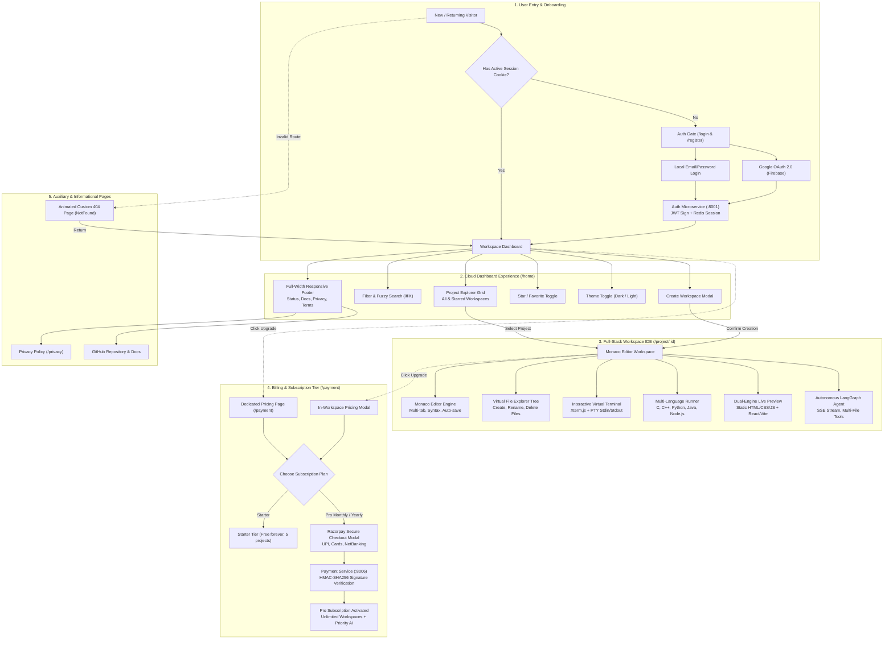

---

## 🌟 Key Features

- 🖥️ **Full-Fledged In-Browser IDE**: Built on Monaco Editor (the editor powering VS Code) with multi-tab management, syntax highlighting, breadcrumb pathing, and live status bar telemetry.
- 🗂️ **Hierarchical Virtual Filesystem**: Self-referencing Mongoose schema supporting deeply nested directories, recursive soft deletes, and alphabetical directory tree synthesis (`buildTree`).
- 🎨 **Extension-Accurate Brand Icons**: Custom file icon engine rendering brand-authentic logos and palettes (`.jsx` React Cyan, `.js` JS Yellow, `.ts` TS Blue, `.html` Orange, `.css` Blue, `.json` Amber, `.py` Python Blue, etc.).
- 💻 **Integrated Virtual Terminal**: Built with `@xterm/xterm` and `@xterm/addon-fit`, equipped with ANSI color schemes, key event bindings, and simulated interactive commands (`npm run dev`, `ls`, `clear`, `help`).
- 🤖 **Autonomous AI Agent**: LangGraph-driven state machine running on OpenRouter with strict token & cost guards, streaming tool executions via Server-Sent Events (SSE) to autonomously inspect the file tree, read files, generate code, update existing files, and build folder structures.
- ⚡ **Built-In Live Preview (`Code | Split | Preview`)**: In-browser sandbox supporting both **React + Vite** (`@babel/standalone` + `esm.sh` + Tailwind CSS) and **HTML + CSS + JavaScript** apps, complete with viewport toggles, sandbox storage shims, and runtime error reporting.
- 🛡️ **Zero-Cost LLM Budget Guarding**: Hardened configuration featuring token caps (`MAX_TOKENS`), low deterministic temperature (`0.1`), retry elimination (`maxRetries: 0`), timeout cutoffs, and strict `$0` price ceilings (`max_price: { prompt: 0, completion: 0 }`) loaded cleanly from `.env`.
- 🔐 **Microservice Security & Auth**: Reverse-proxied sessions, cookie management, JWT authentication, and user header decoration (`x-user-id`, `x-user-email`) protecting microservices.
- 🎨 **Futuristic Design System**: Minimalist slate and dark-mode aesthetic built with Tailwind CSS v4, smooth spring animations via Framer Motion, and responsive panel toggling.

---

## 🏗️ System Architecture

BHASHA AI-IDE is organized into three decoupled layers: **Client SPA Tier**, **API Ingress Controller (Gateway)**, and **Microservice Compute Cluster**, integrated with persistent NoSQL/cache databases and external developer APIs.

### 1. High-Level Ingress & Microservices Topology

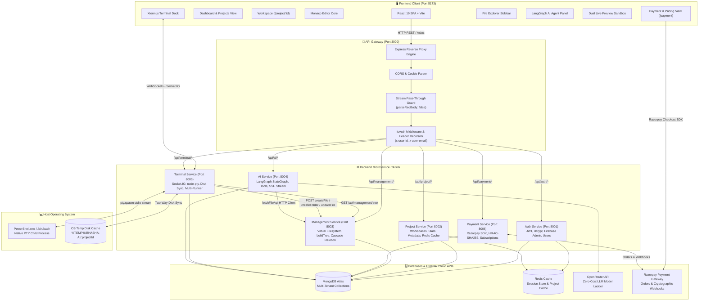

### 2. Multi-Service Data Lifecycle & Real-Time Sync Flow

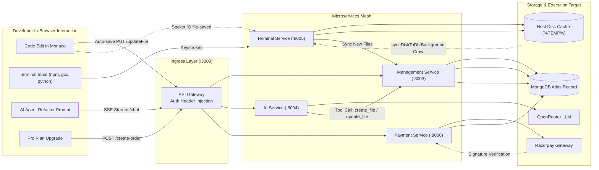

---

## 🏷️ Technologies & Labels

### Frontend
| Technology | Badge | Description |
| :--- | :--- | :--- |
| **React 19** |  | Next-generation React core with modern hooks and fast rendering |
| **Vite 8** |  | Lightning-fast development server and optimized Rolldown/ESM bundler |
| **Tailwind CSS v4** |  | Modern utility-first CSS engine using native CSS `@import` |
| **Monaco Editor** |  | Full-featured code editor engine with dark theme and syntax highlighting |
| **Xterm.js** |  | Browser-based terminal emulator component with `@xterm/addon-fit` |
| **Redux Toolkit** |  | Global state management for authentication and session persistence |
| **React Router** |  | Client-side routing for `/login`, `/home`, and `/project/:id` |
| **Framer Motion** |  | Declarative layout animations, modals, and tab transitions |
| **React Icons** |  | Comprehensive icon packs (VS Code `vsc`, Simple Icons `si`, Feather `fi`) |

### Backend & AI Infrastructure
| Technology | Badge | Description |
| :--- | :--- | :--- |
| **Node.js** |  | Modern JavaScript runtime supporting ES Modules |
| **Express.js v5** |  | Scalable HTTP microservices and routing framework |
| **Express HTTP Proxy** |  | High-performance reverse proxy for API Gateway routing |
| **MongoDB Atlas** |  | Multi-cluster cloud NoSQL database with Mongoose ODM |
| **LangChain Core** |  | Modular framework for building LLM agents and tool calling |
| **LangGraph** |  | State graph orchestration for multi-step AI reasoning loops |
| **OpenRouter** |  | Unified LLM routing provider configured via environment variables |
| **Zod** |  | Strict runtime schema validation for AI agent tool inputs |
| **JWT** |  | Secure token authentication across cookies and internal microservices |
| **Firebase Admin** |  | Authentication verification and social Google OAuth login |

---

## 🧩 Microservices Deep Dive

```
backend/
├── gateway/              # Reverse Proxy API Gateway (Port 3000)
└── services/
    ├── auth/             # Authentication & User Management (Port 8001)
    ├── project/          # Project Workspaces & Metadata (Port 8002)
    ├── management/       # Virtual Filesystem & Directory Trees (Port 8003)
    ├── AI/               # LangGraph Autonomous Agent & LLM Tools (Port 8004)
    ├── terminal/         # Interactive Terminal & Real-Time Sync (Port 8005)
    └── payment/          # Monetization & Razorpay Payment Service (Port 8006)
```

### 1. API Gateway (`backend/gateway`)
The central ingress controller for the entire architecture.
- **Port**: `3000`
- **Responsibilities**:
  - Handles Cross-Origin Resource Sharing (CORS) with `credentials: true`.
  - Cookie parsing and request access logging (`morgan`).
  - Enforces `isAuth` verification on protected routes.
  - Decorates requests heading to internal services with identity headers:
    - `x-user-id`: MongoDB user ID
    - `x-user-email`: Authenticated user email
  - Routes traffic seamlessly to underlying microservices:
    - `/api/auth` ➔ `AUTH_SERVICE` (8001)
    - `/api/project` ➔ `PROJECT_SERVICE` (8002)
    - `/api/management` ➔ `MANAGEMENT_SERVICE` (8003)
    - `/api/ai` ➔ `AI_SERVICE` (8004)
    - `/api/terminal` ➔ `TERMINAL_SERVICE` (8005)
    - `/api/payment` ➔ `PAYMENT_SERVICE` (8006)

#### 🔄 API Gateway Ingress & Request Pipeline Flow
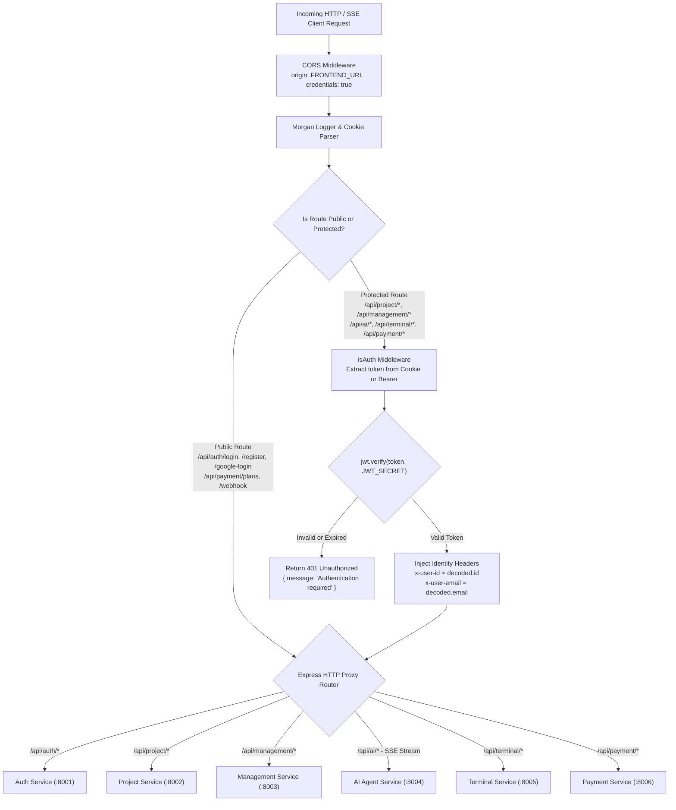

---

### 2. Authentication Microservice (`backend/services/auth`)
Responsible for identity lifecycle, credential verification, and session persistence.
- **Port**: `8001`
- **Core Technologies**: `bcryptjs`, `jsonwebtoken`, `firebase-admin`, `redis`, `mongoose`.
- **Key Features**:
  - **Local Credentials**: Safe registration with 10-round bcrypt password hashing and uniqueness validation.
  - **Google OAuth 2.0 Integration**: Verifies Firebase Google ID tokens via `firebaseAdmin.auth().verifyIdToken()`, creating or updating user profiles dynamically.
  - **JWT Session Issuance**: Issues tamper-evident 7-day signed JSON Web Tokens stored in `httpOnly` cookies.
  - **Redis Session Caching**: In-memory caching for `GET /api/auth/user` reducing MongoDB query load.

#### 🔐 Authentication & Session Lifecycle Flow
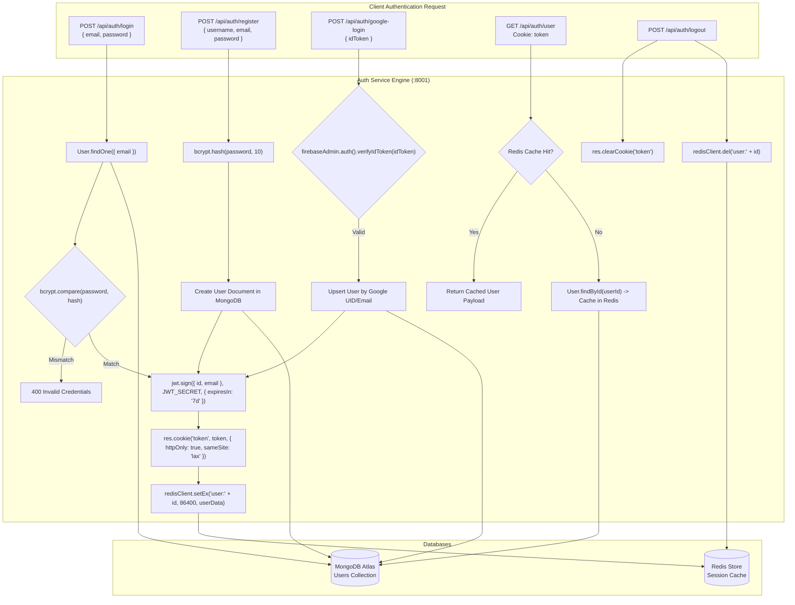

---

### 3. Project Microservice (`backend/services/project`)
Responsible for project workspace management, metadata indexing, favorites/starring, and workspace lifecycle hooks.
- **Port**: `8002`
- **Core Technologies**: `express`, `mongoose`, `redis`, `axios`.
- **Key Features**:
  - **Workspace Provisioning**: Creates workspace records and invokes the Management Service to automatically scaffold the root project directory.
  - **High-Performance Caching**: Caches user project listings in Redis (`projects-${userId}`) with automatic invalidation on any write, edit, like, or delete.
  - **Favorite / Star Toggle**: `PATCH /api/project/like/:id` updates MongoDB array `$push` / `$pull` atomically.
  - **Safe Cascading Deletion**: Flags project as `isDeleted: true` and coordinates sub-tree purging.

#### 📁 Project Management & Cache Invalidation Flow
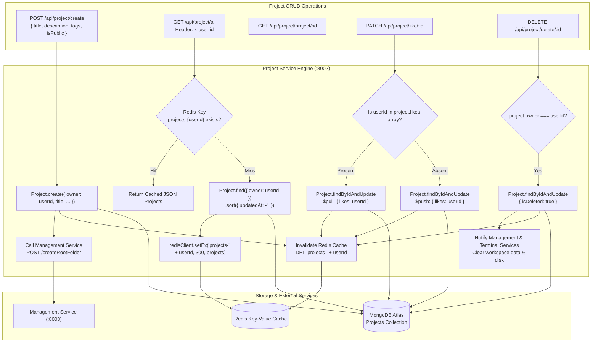

---

### 4. Management Microservice (`backend/services/management`)
Responsible for modeling, storing, and organizing nested project filesystems.
- **Port**: `8003`
- **Database Model (`File` Schema)**:
  - `owner`: Reference to User.
  - `projectId`: Reference to Project.
  - `parentId`: Self-reference to `File._id` (`null` for workspace root).
  - `name`: Clean filename or folder name.
  - `type`: Enum `['file', 'folder']`.
  - `content`: Full string code content.
  - `language`: Code language identifier (e.g. `javascript`, `css`).
  - `extension`: Computed extension (e.g. `jsx`, `json`).
  - `size`: Byte length of content.
  - `isDeleted`: Soft-delete flag (preserves project history).
  - **Compound Unique Index**: `(projectId, parentId, name, isDeleted)` preventing duplicate filenames inside the same folder.
- **`buildTree` Algorithm**:
  - Transforms flat MongoDB query results into a recursive directory tree in $O(N)$ time using map indexing.
  - Automatically sorts folders before files alphabetically.
- **Cascade Deletion**:
  - `deleteFolder` iteratively resolves all nested child folder and file IDs across arbitrary tree depths and soft-deletes the entire sub-tree atomically.

#### 🗂️ Virtual Filesystem & Recursive Tree Flow
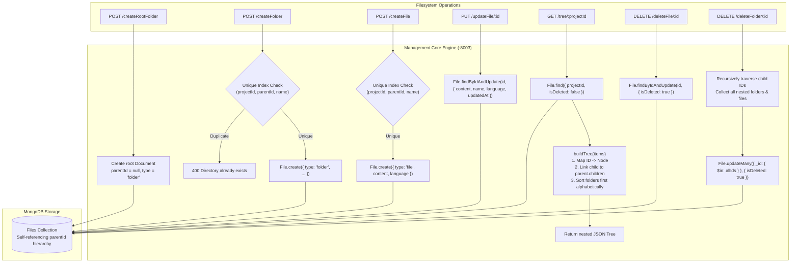

---

### 5. AI Agent Microservice (`backend/services/AI`)
Responsible for intelligent pair-programming, automated workspace scaffolding, and code editing over real-time SSE streaming.
- **Port**: `8004`
- **Engine**: LangGraph state machine powered by `@langchain/openrouter` with safe `ToolMessage`-aware context window trimming (`maxMessage = 30`).
- **Models Configured (via `.env` `OPENROUTER_MODEL` & `OPENROUTER_FALLBACK_MODELS`)**:
  1. **`cohere/north-mini-code:free`** *(Primary)* — Coding-specialized free model (`256k` context, `tools` / `tool_choice` support) delivering fast, accurate filesystem tool calls.
  2. **`nvidia/nemotron-3-ultra-550b-a55b:free`** *(Fallback 1)* — High-capacity 550B MoE free model (`1M` context, `tools` support) used as backup for complex multi-file reasoning.
  3. **`openrouter/free`** *(Fallback 2)* — OpenRouter's official `$0.00` auto-router (`200k` context) that dynamically selects active tool-capable free models if individual promotional slugs rotate.
- **Guardrails (`llm.js` & `ai.controllers.js`)**:
  - Zero hardcoded model strings in source code (loaded strictly from `.env`).
  - Strict low temperature (`0.1`) eliminating token waste and hallucination.
  - Configurable max token ceiling (`MAX_TOKENS=4096`) to prevent mid-file JSON tool truncation.
  - Hard zero-cost price limit (`max_price: { prompt: 0, completion: 0 }`) with 3-model OpenRouter cap.
  - Timeout cutoff (`60000ms`), `maxRetries: 0`, and friendly `429` quota/reset error formatting.
- **Internal API Client (`fetchFileApi.js`)**:
  - Provides reliable inter-service HTTP communication directly to the Management Service with `x-user-id` forwarding.

#### 🤖 LangGraph Agent SSE Streaming & Tool Execution Loop
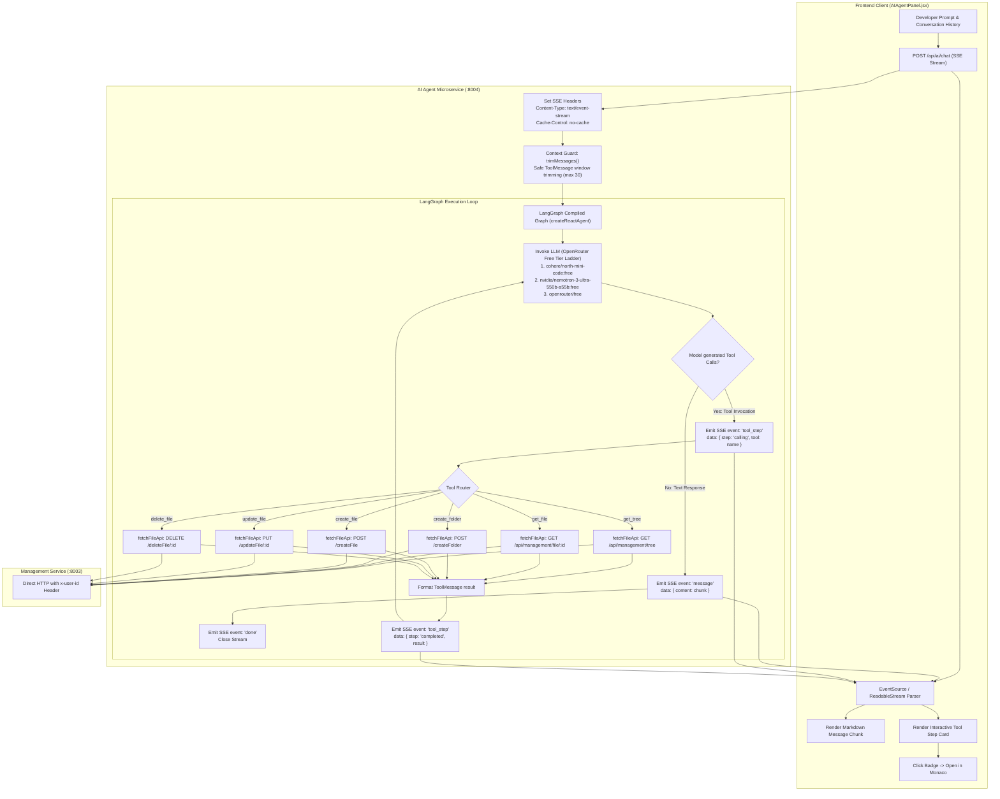

---

### 6. Interactive Terminal Microservice (`backend/services/terminal`)
Responsible for live command execution, pseudo-terminal (PTY) emulation, and real-time bidirectional project synchronization between OS disk and MongoDB.
- **Port**: `8005`
- **Core Technologies**: `socket.io`, `node-pty`, `axios`, `express`, `mongoose`.
- **Shell Spawning (`SHELL`)**: Dynamically resolves `powershell.exe` on Windows (`win32`) and `/bin/bash` on Linux/macOS.

#### 🔄 Two-Way Virtual Filesystem & Disk Synchronization Engine
A major challenge in browser-based IDEs is maintaining consistency between a database-backed virtual filesystem (MongoDB) and a native operating system shell executing on disk:
1. **The Discrepancy Problem**: When developers run commands inside the integrated terminal (e.g. `npm init -y`, `npm install`, `touch app.py`, `npx create-vite`), files and folders are written directly to the host operating system's temporary directory (`%TEMP%/BHASHA-AI/:projectId`). Because the File Explorer sidebar renders exclusively from MongoDB via the Management Service (`GET /api/management/tree/:projectId`), newly generated files were previously invisible until manual intervention.
2. **Recursive Disk-to-DB Synchronization (`syncDiskToDb`)**:
   - The Terminal Service recursively crawls the project's OS directory starting at `getProjectPath(projectId)`.
   - Compares relative file paths against the current MongoDB hierarchy retrieved via `getTree(projectId, userId)`.
   - **Exclusion Filters**: Automatically ignores bulky build and VCS artifacts (`node_modules`, `.git`, `.DS_Store`, `Thumbs.db`, `.cache`) as well as binary files exceeding 5MB to preserve MongoDB throughput and storage efficiency.
   - **Folder Creation**: Detects newly created disk directories and issues `POST /api/management/createFolder` under the corresponding parent MongoDB folder.
   - **File Creation & Language Detection**: Reads UTF-8 file content, determines Monaco syntax modes (JavaScript, TypeScript, HTML, CSS, JSON, Python, etc.), and issues `POST /api/management/createFile` with content and language metadata.
   - **Change Detection**: Compares disk file content against database records and issues `PUT /api/management/updateFile/:id` when local edits occur.
3. **Smart Debounced Shell Activity Sync**:
   - When the developer executes a command in the terminal (pressing <kbd>Enter</kbd> / `\r` / `\n`), a `1.2s` debounce timer is armed.
   - Once the terminal output settles, `syncDiskToDb()` automatically executes in the background.
   - Upon detecting created or modified files, the server emits a `disk-synced` event over Socket.IO, prompting the frontend File Explorer to seamlessly reload without user intervention.
4. **On-Demand & Ingress Gateway Sync (`POST /api/terminal/sync` & `POST /sync-disk`)**:
   - When the developer clicks the **Refresh** button (`VscRefresh`) in the File Explorer, or when the project workspace initializes, the frontend dispatches a sync request through the API Gateway, ensuring immediate synchronization even before the user opens the terminal.
5. **Reverse Disk Sync (Monaco Editor ➔ OS Disk)**:
   - Saves made in the Monaco Editor emit `file-saved` over Socket.IO, which writes the modified code directly into the workspace disk directory.
   - File deletions in the Explorer emit `file-deleted`, instantly removing the corresponding file from the host disk.

#### 🛡️ Anti-Resurrection Deletion Architecture
A subtle and critical bug in filesystem synchronization engines is **zombie file resurrection**:
- **The Problem**: In a soft-delete architecture, calling `DELETE /api/management/deleteFile/:id` marks the document as `isDeleted: true` in MongoDB. However, the physical file previously stayed on the local temporary disk (`%TEMP%/BHASHA-AI/:projectId`). When the background sync engine ran, it queried the active file tree (`isDeleted: false`), observed that the file on disk was missing from the active list, and mistakenly assumed it was a newly created file. It called `createFile`, resurrecting the deleted file in MongoDB and restoring it to the File Explorer.
- **The Solution**:
  1. The Management Service exposes `GET /api/management/all-files/:projectId`, returning all project documents (both active and soft-deleted).
  2. The Terminal sync engine builds two mutually exclusive lookup sets: `activeMap` and `deletedMap`.
  3. **Immediate Disk Purge**: Any path present in `deletedMap` that exists on disk is immediately removed using `fs.rm(diskPath, { recursive: true, force: true })`.
  4. **Creation Guard**: The disk walk explicitly skips any path registered in `deletedMap`, completely preventing soft-deleted files from ever being resurrected.
  5. **Client-Side Trigger**: When the developer deletes a file or folder in `FileExplorer.jsx`, `handleDeleteFile` in `Project.jsx` dispatches `syncTerminalDisk()` immediately after the API call, ensuring the physical disk is purged synchronously with the UI update.

#### 🔒 Terminal Service Security Hardening & Zero-Leak Isolation
Because the integrated terminal grants developers interactive shell access (`powershell.exe` on Windows, `bash` on Linux), multiple security guard rails are enforced to prevent host credential leaks, unauthorized workspace tampering, and filesystem escaping:
1. **Host Environment Variable Sanitization (`buildSafeEnvironment`)**:
   - `pty.spawn` strictly sanitizes the environment passed to child shells, eliminating host secrets (`MONGO_URL`, `JWT_SECRET`, `REDIS_URL`, `GEMINI_API_KEY`, `OPENROUTER_API_KEY`).
   - Uses an explicit whitelist of developer execution paths (`PATH`, `PATHEXT`, `SYSTEMROOT`, `COMSPEC`, `TEMP`, `TMP`, `TERM`, `USERPROFILE`, `HOME`, `PSModulePath`).
   - Applies an active regex blacklist `/(secret|token|password|passwd|key|mongo|redis|jwt|auth|credential|db_url|database|gemini|openai)/i` to strip sensitive credentials even if defined on the host system.
   - Preserves compiler toolchains (`gcc`, `g++`, `python`, `node`, `javac`) while completely isolating sensitive infrastructure keys from commands such as `Get-ChildItem env:` or `env`.
2. **Directory Traversal Defense & Path Containment**:
   - `isValidProjectId` enforces a strict alphanumeric pattern (`/^[a-zA-Z0-9_-]{1,64}$/`), blocking shell metacharacters and relative path operators (`..`, `/`, `\`).
   - `getProjectPath` uses `path.resolve` to guarantee that workspace roots strictly reside within `%TEMP%/BHASHA-AI/`.
   - `isSafeSubPath` validates all incoming `file-saved` and `file-deleted` paths, blocking path escaping attempts and null-byte injection (`\0`).
3. **Workspace Ownership Verification & Socket Authentication**:
   - WebSocket handshakes require `{ projectId, userId }` in both `auth` metadata and `terminalData` session payloads.
   - The terminal service queries the Project Service (`GET /api/project/project/:id`) and Management Service (`GET /api/management/tree/:id`) with `x-user-id` to verify workspace ownership before instantiating the PTY process.
   - Unauthorized attempts immediately emit a security error to the client terminal and terminate the WebSocket connection.
4. **Denial-of-Service Defense & Process Resource Governance**:
   - **Spawn Rate Limiting**: Enforces a sliding window cap (`10 shell initializations per socket per minute`) to protect the host against rapid connection looping or fork-bombing.
   - **30-Minute Idle Timeout**: Dormant terminal processes are automatically terminated after 30 minutes of inactivity (`SESSION_IDLE_TIMEOUT_MS = 1800000`), freeing RAM, CPU threads, and file descriptors.
   - **Security Audit Telemetry**: `logSecurityEvent` provides structured forensic audit logging for unauthenticated access attempts, path traversal blocks, rate-limit violations, and PTY lifecycle events.

| Threat Vector | Attack Scenario | Mitigation in BHASHA IDE |
| :--- | :--- | :--- |
| **Credential Exfiltration** | Running `Get-ChildItem env:` or `env` inside terminal to steal MongoDB or Redis credentials | `buildSafeEnvironment()` strips all credentials using whitelist and regex blacklist |
| **Path Traversal Escape** | Supplying `../../Windows/System32` or `../other-user-project` in project ID or relative path | Strict alphanumeric validation (`/^[a-zA-Z0-9_-]{1,64}$/`) and `isSafeSubPath()` containment check |
| **Cross-Tenant Hijacking** | Specifying another user's `projectId` in Socket.IO handshake to execute commands in their workspace | `verifyProjectOwnership()` cross-checks project ownership against Project & Management microservices |
| **Process Fork Bombing** | Rapidly opening hundreds of WebSocket terminal instances to exhaust host CPU and memory | Rate limiter caps spawns to 10/min per socket; idle timer cleans up dormant PTYs after 30 minutes |
| **Zombie Process Leaks** | Abandoned terminal sessions lingering indefinitely on host server | Automatic 30-minute idle lifecycle termination with graceful `SIGTERM` cleanup |

#### 🚀 In-Terminal Development Server Lifecycle (`npm run dev`)
Developers executing full-stack development commands within the integrated terminal benefit from a clean development environment:
- **Missing Script & Dependency Prevention**: Running `npm run dev` in standard frontend setups requires:
  1. A configured `"dev"` script in `package.json` (e.g. `"dev": "vite"` or `"dev": "node server.js"`).
  2. Corresponding development dependencies installed in `node_modules` (e.g. `vite`, `@vitejs/plugin-react`).
- **Port Collision Prevention**: The BHASHA IDE host web application executes on `http://localhost:5173`. When configuring or launching development servers (such as Vite) inside the integrated terminal, specify an isolated port (such as `--port 5174` or `PORT=5000`) so the inner workspace server runs concurrently without conflicting with the IDE parent process.
- **Dual Preview Capabilities**:
  - **In-Browser Sandboxed Live Preview (`PreviewPanel.jsx`)**: Instant client-side bundling powered by `@babel/standalone`, `esm.sh`, and Tailwind CSS that compiles and displays React and HTML apps directly inside an iframe without requiring an active terminal process.
  - **Native PTY Server (`npm run dev` in `TerminalPanel.jsx`)**: Full native Node.js / Vite / Express runtime with real network binding, backend route handling, and standard CLI logs.

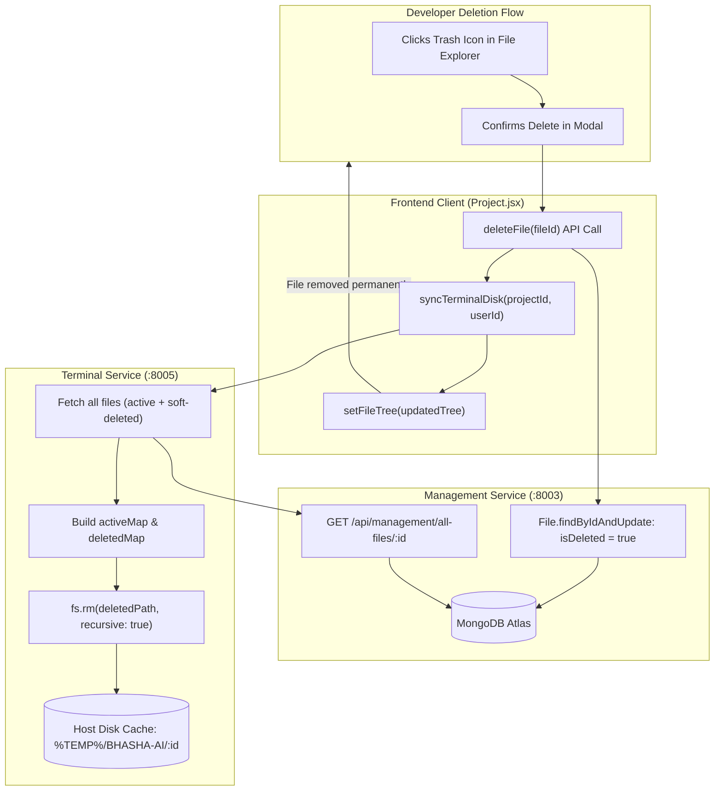

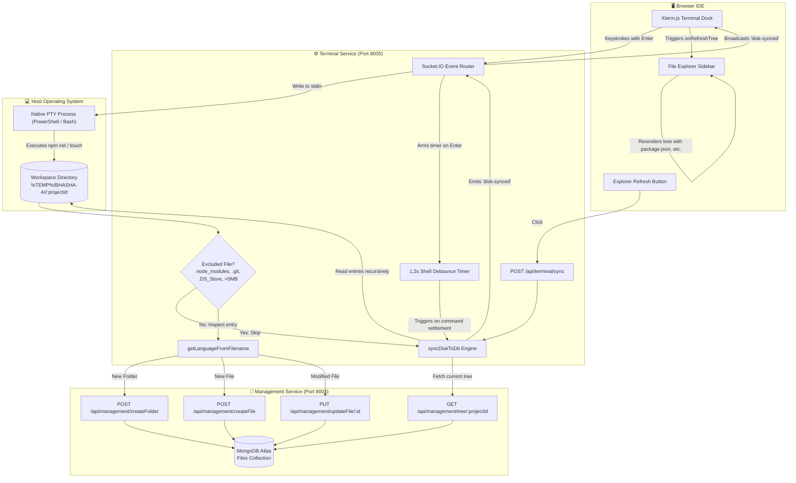

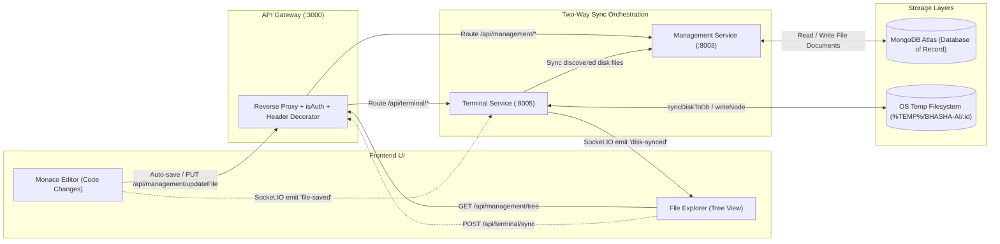

```mermaid
sequenceDiagram
    autonumber
    actor Developer as Developer
    participant Xterm as Frontend Terminal (Xterm.js)
    participant Socket as Socket.IO Client
    participant TermService as Terminal Service (:8005)
    participant MgmtService as Management Service (:8003)
    participant Disk as Local Disk Cache (%TEMP%)
    participant PTY as Native PTY (PowerShell / Bash)
    participant Explorer as File Explorer Sidebar

    Developer->>Xterm: Clicks Terminal Dock Toggle
    Xterm->>Socket: io.connect("http://localhost:8005")
    Socket->>TermService: emit("terminalData", { projectId, userId, cols, rows })
    
    rect rgb(20, 25, 40)
        Note over TermService,Disk: Initial Synchronization Phase
        TermService->>MgmtService: GET /api/management/tree/:projectId (x-user-id)
        MgmtService-->>TermService: Returns recursive JSON file tree
        TermService->>Disk: writeNode() materializes database files to %TEMP%/BHASHA-AI/:id
        TermService->>TermService: syncDiskToDb() scans disk for offline additions
    end

    rect rgb(25, 35, 25)
        Note over TermService,PTY: Shell Spawning Phase
        TermService->>PTY: pty.spawn(SHELL, [], { cwd: projectRoot, cols, rows })
        TermService->>Socket: emit("terminal-ready", { cols, rows })
        Socket->>Xterm: Updates status badge to "connected"
    end

    rect rgb(30, 25, 35)
        Note over Developer,PTY: Interactive Keystroke & ANSI Output Loop
        Developer->>Xterm: Types "npm init -y" + Enter
        Xterm->>Socket: term.onData -> emit("terminal-write", "npm init -y\r")
        Socket->>TermService: socket.on("terminal-write")
        TermService->>PTY: ptyProcess.write("npm init -y\r")
        PTY-->>Disk: Creates package.json on disk
        PTY-->>TermService: ptyProcess.onData(ansiOutput)
        TermService-->>Socket: emit("terminalData", ansiOutput)
        Socket-->>Xterm: term.write(ansiOutput)
    end

    rect rgb(35, 30, 25)
        Note over TermService,Explorer: Automated Disk-to-DB Sync Loop
        TermService->>TermService: 1.2s Debounce timer fires after Enter
        TermService->>Disk: fs.readdir(projectRoot) detects package.json
        TermService->>MgmtService: POST /api/management/createFile (package.json)
        MgmtService-->>TermService: 201 Created (persisted to MongoDB)
        TermService-->>Socket: emit("disk-synced")
        Socket-->>Xterm: socket.on("disk-synced")
        Xterm->>Explorer: onRefreshTree(false)
        Explorer->>MgmtService: GET /api/management/tree/:projectId
        MgmtService-->>Explorer: Updated tree with package.json
        Explorer-->>Developer: package.json appears in sidebar with JSON icon
    end

    Developer->>Xterm: Closes terminal / leaves workspace
    Xterm->>Socket: socket.disconnect()
    Socket->>TermService: socket.on("disconnect")
    TermService->>PTY: ptyProcess.kill() & sessions.delete(socket.id)
```

---

### 7. Monetization & Payment Microservice (`backend/services/payment`)
Responsible for platform monetization, subscription tiers, Razorpay payment processing, and cryptographic verification.
- **Port**: `8006`
- **Core Technologies**: `razorpay`, `crypto`, `express`, `mongoose`.
- **Key Features**:
  - **Authoritative Plan Catalog**: Exposes `GET /api/payment/plans` returning pricing matrices, billing intervals, token allowances, and enterprise feature lists.
  - **Order Generation**: Creates orders via official `razorpay.orders.create` with unique timestamped receipts and paise amount calculations (e.g., ₹799 ➔ `79900`).
  - **Cryptographic HMAC-SHA256 Verification**: Verifies payment legitimacy by computing `sha256(order_id + "|" + payment_id)` with `RAZORPAY_KEY_SECRET` and comparing using `crypto.timingSafeEqual` to eliminate timing attack vulnerabilities.
  - **Subscription Lifecycle Management**: Updates user records upon successful payment, provisioning 1,000,000 AI tokens, unlimited project slots, and 30-day/365-day billing period calculations.
  - **Asynchronous Webhook Processing**: Listens for Razorpay webhook notifications (`order.paid`, `payment.captured`, `payment.failed`) with raw signature validation for automated recovery.

#### 💳 Razorpay Order Generation, Signature Verification & Subscription Flow
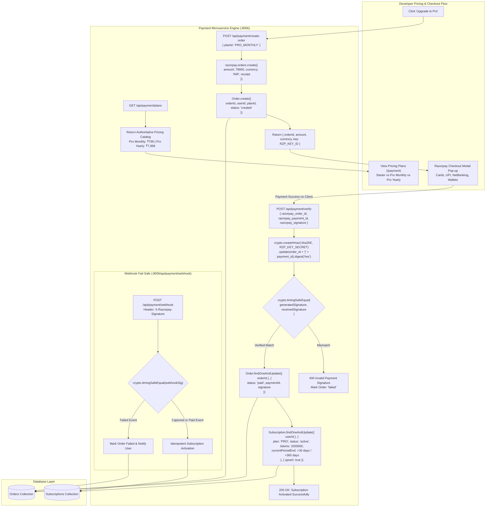

---

## 💻 Frontend Workspace Experience

Located at [`frontend/`](file:///c:/Users/263237/Desktop/MERN/AI-Editor/frontend), the web interface offers a high-performance, responsive desktop IDE experience.

### 1. Dashboard & Project Management (`/home`)
- **Projects Grid**: Displays workspace cards with dynamic status dots, project tags, and timestamp indicators (`timeAgo`).
- **Starring & Filtering**: 1-click star/unstar action with dynamic counter badges (`Starred (N)` vs `Projects (N)`).
- **Search & Keyboard Shortcuts**: Instant search filter with `⌘K` / `Ctrl+K` keyboard listener.
- **Modals**: Smooth Framer Motion dialogs for New Project Creation and Delete Confirmation.

### 2. Main IDE Workspace (`/project/:id`)
- **Activity Bar**: Slim VS Code-style vertical rail providing one-click access to Explorer, Search, Source Control, AI Agent, and Settings.
- **File Explorer (`FileExplorer.jsx`)**:
  - Nested folder tree with recursive expansion and collapse.
  - Header actions: *New File*, *New Folder*, *Refresh*, *Collapse All*, and *Delete All* (Clear Workspace).
  - Safety confirmation modal for single-item and bulk "Delete All" operations.
  - Inline input creation with blur and keyboard submit.
- **Extension-Accurate Brand Icons (`fileIcons.jsx`)**:
  - Dynamically extracts extensions and renders authentic brand SVG icons:
    - ⚛️ `.jsx` ➔ React Atom Cyan (`#61DAFB`)
    - 🟨 `.js`, `.mjs` ➔ JavaScript Yellow (`#F7DF1E`)
    - 🟦 `.ts` ➔ TypeScript Navy (`#3178C6`)
    - ⚛️ `.tsx` ➔ TypeScript React Sky Blue (`#38BDF8`)
    - 🟧 `.html` ➔ HTML5 Orange (`#E34F26`)
    - 🎨 `.css` ➔ CSS3 Royal Blue (`#2563EB`)
    - 📦 `.json` ➔ JSON Warm Amber (`#F59E0B`)
    - 📝 `.md` ➔ Markdown Sky Blue (`#38BDF8`)
    - 🐍 `.py` ➔ Python Blue (`#3776AB`)
    - 🦀 `.rs` ➔ Rust Terracotta (`#DEA584`)
    - 🔒 `.env*` ➔ Secure Key Lock (`#FACC15`)
    - 🖼️ `.png`, `.jpg` ➔ Media Emerald (`#34D399`)
- **Monaco Code Editor (`CodeEditor.jsx`)**:
  - Integrated via `@monaco-editor/react`.
  - Multi-file tab bar with active tab indicators and close triggers (`×`).
  - Custom dark theme matching `#07090e` workspace aesthetic.
  - Breadcrumbs path tracker (`src > App.jsx`) with live saved status.
  - Live cursor tracking in footer (`Ln 14, Col 22`, `UTF-8`, `Spaces: 2`).
- **Interactive Terminal Dock (`TerminalPanel.jsx`)**:
  - Powered by `@xterm/xterm`, `@xterm/addon-fit`, and `socket.io-client`.
  - Dock tabs: `TERMINAL`, `OUTPUT`, `PROBLEMS (0)`, `DEBUG CONSOLE`.
  - **Live Bidirectional PTY Streaming**: Connects directly to the Terminal Microservice via WebSockets (`http://localhost:8005`), syncing the active project's file hierarchy into a real OS temp directory and spawning a native interactive shell (`PowerShell` or `Bash`).
  - **Full Terminal Emulation**: Supports real CLI execution (e.g., `npm install`, `node index.js`, `python script.py`, `git status`, `ls`, `cat`), ANSI 256-color palettes, Tab auto-complete, arrow key navigation, text copy/paste, and `Ctrl+C` interrupt signals.
  - **VS Code-Style Vertical Drag-to-Resize**: Top edge drag handle (`h-2`, `cursor-row-resize`) with an interactive centered visual grab indicator that expands on hover. Enables fluid mouse-drag resizing between `90px` and `85vh` (`window.innerHeight * 0.85`), with automatic text selection prevention (`user-select: none`) and transition bypass (`transition-none`) during movement for zero-lag 60fps tracking.
  - **Double-Click Shortcut**: Double-clicking the top resize handle bar toggles maximize (`75vh`) and restore back to the developer's custom dragged height.
  - **Dynamic ResizeObserver Engine**: Terminal canvas uses a native `ResizeObserver` observing `terminalRef.current` that continuously recalculates character grid columns and rows via `fitAddonRef.current.fit()` on every frame and streams `terminal-resize` events to the backend PTY, completely eliminating clipped text or misaligned cursor positions.
  - **Connection Telemetry & Panel Controls**: Live pulsing status pill (`Connected`, `Connecting...`, `Disconnected`), 1-click Reconnect button, Clear screen, Split toggle, Maximize/Restore dock height, and Close.
  - **Automated Real-Time Tree Sync**: Terminal panel listens for `disk-synced` events from the backend, triggering silent file tree reloads (`onRefreshTree(false)`) so CLI-generated files (`package.json`, `package-lock.json`, new folders) immediately appear in the File Explorer.

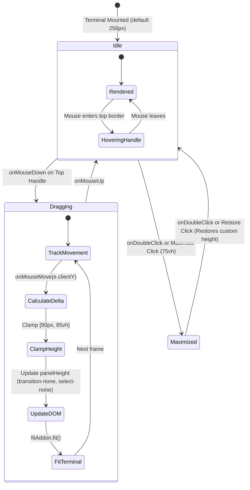
- **AI Agent Panel (`AIAgentPanel.jsx` & `features/ai.js`)**:
  - Real-time AI copilot sidebar streaming tool actions via Server-Sent Events (`fetch` + `ReadableStream`).
  - Live step-by-step tool activity cards with clickable file badges that open created/updated files directly in Monaco.
  - Instant workspace synchronization (`handleAIFileMutated`) updating the tree, open tabs, and live preview automatically, with abort/stop support (`AbortController`).
- **Live Browser Preview (`PreviewPanel.jsx` & `utils/previewBuilder.js`)**:
  - `Code | Split | Preview` view modes with Desktop/Tablet/Mobile viewport switching, manual reload, and open-in-new-tab.
  - Compiles **React + Vite** projects in-browser via `@babel/standalone`, `esm.sh`, and Tailwind CSS auto-detection, and bundles **Plain HTML + CSS + JavaScript** apps with inline stylesheet/script resolution and an in-memory `localStorage`/`sessionStorage` sandbox shim.
  - Shows `"Can't preview this project"` cleanly for non-browser technologies (e.g., Node.js backends, Python scripts).

---

## ⚡ Multi-Language Execution & Compiler Engine (Python, C, C++, Java, Node.js)

BHASHA features a VS Code-style **Context-Aware Code Runner** that enables seamless, isolated execution for multi-language projects directly within the integrated terminal dock. Developers can create a standalone Python file (`test.py`), C file (`main.c`), or C++ file (`main.cpp`), write code, and run it with one click without affecting any other files or services in the workspace.

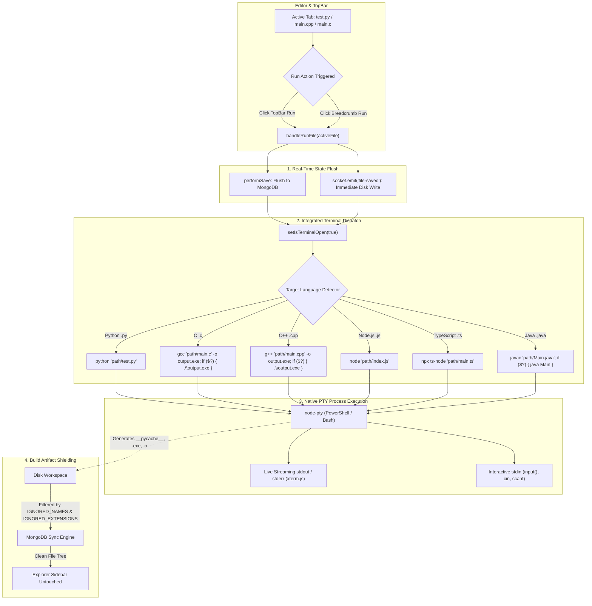

### Supported Languages & Execution Matrix

| Language | Extensions | Syntax Grammar | Authentic Icon | CLI Compiler / Runtime | Auto-Generated Run Command |
| :--- | :--- | :--- | :--- | :--- | :--- |
| **Python** | `.py`, `.pyw`, `.pyi` | `python` | `SiPython` (`#3776AB`) | Python 3.x | `python "<relPath>"` |
| **C** | `.c`, `.h` | `c` | `SiC` (`#A8B9CC`) | GCC (MinGW / Clang) | `gcc "<relPath>" -o output.exe; if ($?) { & .\output.exe }` |
| **C++** | `.cpp`, `.c++`, `.cc`, `.cxx`, `.cp`, `.hpp`, `.h++` | `cpp` | `SiCplusplus` (`#00599C`) | G++ (MinGW / Clang) | `g++ "<relPath>" -o output.exe; if ($?) { & .\output.exe }` |
| **JavaScript** | `.js`, `.mjs`, `.cjs` | `javascript` | `SiJavascript` (`#F7DF1E`) | Node.js | `node "<relPath>"` |
| **TypeScript** | `.ts`, `.tsx` | `typescript` | `SiTypescript` (`#3178C6`) | `ts-node` / Node.js | `npx ts-node "<relPath>"` |
| **Java** | `.java` | `java` | `SiOpenjdk` (`#ED8B00`) | OpenJDK (`javac`, `java`) | `javac "<relPath>"; if ($?) { java "<ClassName>" }` |
| **Rust** | `.rs` | `rust` | `SiRust` (`#DEA584`) | `rustc` / Cargo | `rustc "<relPath>" -o output.exe; if ($?) { & .\output.exe }` |
| **Go** | `.go` | `go` | `SiGo` (`#00ADD8`) | Go Runtime | `go run "<relPath>"` |
| **Shell / Bash** | `.sh`, `.bash` | `shell` | `VscFileCode` | Bash | `bash "<relPath>"` |

### Anti-Pollution Shielding for Build Artifacts
When compiling C/C++ or running Python scripts, interpreters and compilers produce auxiliary binaries and cache folders:
- Python bytecode: `__pycache__/`, `*.pyc`, `*.pyo`, `.pytest_cache/`
- C/C++ executables & object files: `output.exe`, `*.o`, `*.obj`, `*.pdb`

The sync engine [`backend/services/terminal/index.js`](file:///c:/Users/263237/Desktop/MERN/AI-Editor/backend/services/terminal/index.js) enforces strict filtering via `IGNORED_NAMES` and `IGNORED_EXTENSIONS`:
```javascript
const IGNORED_NAMES = new Set([
    'node_modules', '.git', '.cache', '__pycache__', '.pytest_cache', '.mypy_cache', '.venv', 'venv'
])
const IGNORED_EXTENSIONS = new Set([
    'exe', 'o', 'obj', 'out', 'a', 'lib', 'so', 'dll', 'dylib', 'class', 'pyc', 'pyo', 'pyd'
])
```
This ensures build binaries remain strictly on disk for local execution and are **never** persisted to MongoDB or displayed as clutter in the File Explorer.

### Multi-Language Execution Sequence Flow

```mermaid
sequenceDiagram
    autonumber
    actor Dev as Developer
    participant UI as CodeEditor / TopBar
    participant Mgmt as Management Service (Port 8003)
    participant Term as Terminal Service (Port 8005)
    participant Disk as %TEMP%/BHASHA-AI (Disk)
    participant PTY as PowerShell / Bash PTY
    participant Xterm as Xterm.js Terminal Dock

    Dev->>UI: Click '▶ Run [filename]' (e.g. test.c++, test.py, test.c)
    UI->>Mgmt: PUT /updateFile/:id (Immediate flush to MongoDB)
    UI->>Term: WS emit('file-saved', { relPath, content })
    Term->>Disk: fs.writeFile(fullPath, content)
    UI->>Term: WS emit('terminal-write', cmd + '\r')
    Note over Term,PTY: Invokes runtime or compiler:<br/>Python: python "test.py"<br/>C++: g++ "test.c++" -o output.exe; if ($?) { & .\output.exe }<br/>C: gcc "test.c" -o output.exe; if ($?) { & .\output.exe }<br/>Node: node "index.js"
    Term->>PTY: Write formatted command to shell stdin
    PTY->>Disk: Read source file & compile
    PTY->>Disk: Emit output.exe (Shielded from DB sync)
    PTY-->>Term: Stream stdout / stderr (ANSI color chunks)
    Term-->>Xterm: WS emit('terminalData', data)
    Xterm-->>Dev: Live ANSI output display (Supports input() / cin / Ctrl+C)
```

---

## 🤖 Autonomous AI Agent & LangGraph Tools

The AI Agent in [`backend/services/AI/graph/tools.js`](file:///c:/Users/263237/Desktop/MERN/AI-Editor/backend/services/AI/graph/tools.js) is equipped with a deterministic tool suite designed for real filesystem operations:

| Tool Name | Parameters | Purpose | Strict Rules |
| :--- | :--- | :--- | :--- |
| **`get_tree`** | `{}` | Retrieves complete project folder & file hierarchy. | Call when workspace structure is unknown. Do not call repeatedly. |
| **`get_file`** | `{ fileId }` | Fetches full code content and metadata of a file. | `fileId` must belong to a file (`type="file"`). Never pass a folder ID. |
| **`create_folder`** | `{ name, parentId }` | Creates a new subdirectory under an existing folder. | `parentId` must be a folder ID (or root folder ID). Never use a file as parent. |
| **`create_file`** | `{ name, parentId, content, language }` | Generates a new file with full initial code. | `name` must include extension. Provide complete working code in `content`. |
| **`update_file`** | `{ fileId, content, name, language }` | Overwrites content, renames file, or updates language. | Always inspect with `get_file` first. Provide complete updated code (no partial diffs). |
| **`delete_file`** | `{ fileId }` | Soft-deletes a specific file from the project. | `fileId` must belong to a file. Never pass a folder ID. |

---

## 📡 API Endpoints Reference

### Management Service (`/api/management/*`)
| Method | Endpoint | Description | Request Body / Params |
| :--- | :--- | :--- | :--- |
| `POST` | `/createRootFolder` | Creates root workspace directory | `{ projectId, projectName }` |
| `POST` | `/createFolder` | Creates child folder | `{ projectId, parentId, name }` |
| `POST` | `/createFile` | Creates new code file | `{ projectId, parentId, name, content, language }` |
| `PUT` | `/updateFile/:id` | Updates file content or renames | `{ name?, content?, language? }` |
| `DELETE` | `/deleteFile/:id` | Soft-deletes a single file | URL param: `id` |
| `DELETE` | `/deleteFolder/:id` | Recursively soft-deletes directory & sub-tree | URL param: `id` |
| `DELETE` | `/clearWorkspace/:projectId` | Soft-deletes all non-root files and folders (clears workspace) | URL param: `projectId` |
| `GET` | `/file/:id` | Gets file content and metadata | URL param: `id` |
| `GET` | `/tree/:projectId` | Builds nested directory tree hierarchy | URL param: `projectId` |
| `GET` | `/all-files/:projectId` | Retrieves all project files (active & soft-deleted) for sync | URL param: `projectId` |

### Terminal Service (`/api/terminal/*` & WebSockets)
| Protocol | Method / Event | Endpoint / Event Name | Description | Payload |
| :--- | :--- | :--- | :--- | :--- |
| `HTTP` | `POST` | `/api/terminal/sync` | Gateway-routed sync between workspace disk and MongoDB | `{ projectId, userId? }` (Headers: `x-user-id`) |
| `HTTP` | `POST` | `/sync-disk` | Direct sync endpoint on Terminal Service | `{ projectId, userId? }` |
| `HTTP` | `POST` | `/api/terminal/clear` | Gateway-routed workspace disk purge | `{ projectId }` |
| `HTTP` | `POST` | `/clear-workspace` | Direct endpoint to purge all files from terminal workspace disk | `{ projectId }` |
| `WS` | `Emit` | `terminalData` | Initializes terminal session and spawns PTY | `{ projectId, userId, cols, rows }` |
| `WS` | `Listen` | `terminal-ready` | Confirms PTY shell is online | `{ cols, rows }` |
| `WS` | `Emit` | `terminal-write` | Dispatches user keystrokes to PTY stdin | Raw string / ANSI key codes |
| `WS` | `Listen` | `terminalData` | Streams raw PTY stdout/stderr ANSI color data | ANSI string stream |
| `WS` | `Emit` | `terminal-resize` | Synchronizes cols/rows dimensions to PTY | `(cols: number, rows: number)` |
| `WS` | `Emit` | `sync-to-db` | Manually requests disk-to-DB filesystem sync | None |
| `WS` | `Listen` | `disk-synced` | Signals that disk changes were persisted to MongoDB | `{ success, added, updated }` |
| `WS` | `Emit` | `file-saved` | Syncs editor-saved file directly onto workspace disk | `{ relPath, content }` |
| `WS` | `Emit` | `file-deleted` | Removes deleted file from workspace disk | `{ relPath }` |
| `WS` | `Emit` | `clear-workspace` | Purges all physical files from project disk directory | None |

### Project Service (`/api/project/*`)
| Method | Endpoint | Description |
| :--- | :--- | :--- |
| `POST` | `/create` | Create a new project workspace |
| `GET` | `/all` | Fetch all projects belonging to the authenticated user |
| `PUT` | `/like/:id` | Toggle star/favorite status on a project |
| `DELETE` | `/delete/:id` | Delete a project and its workspace data |

### Payment Service (`/api/payment/*`) — Razorpay Integration
| Protocol | Method | Endpoint | Auth | Description | Payload / Headers |
| :--- | :--- | :--- | :--- | :--- | :--- |
| `HTTP` | `GET` | `/api/payment/plans` | Public | Returns server-authoritative catalog of plans, pricing, and perks | None |
| `HTTP` | `POST` | `/api/payment/create-order` | `isAuth` | Generates a Razorpay order with calculated price in paise | `{ planId: "PRO_MONTHLY" \| "PRO_YEARLY" }` |
| `HTTP` | `POST` | `/api/payment/verify` | `isAuth` | Cryptographically verifies HMAC SHA-256 payment signature & activates subscription | `{ razorpay_order_id, razorpay_payment_id, razorpay_signature }` |
| `HTTP` | `GET` | `/api/payment/subscription` | `isAuth` | Retrieves active user subscription status and token entitlement | None (Header: `x-user-id`) |
| `HTTP` | `GET` | `/api/payment/history` | `isAuth` | Returns chronological transaction and payment history | None (Header: `x-user-id`) |
| `HTTP` | `POST` | `/api/payment/webhook` | Webhook Secret | Asynchronously processes Razorpay events (`payment.captured`, `order.paid`, `payment.failed`) | Headers: `X-Razorpay-Signature`, Raw Body Buffer |

---

## 🚀 Getting Started

### Prerequisites
- **Node.js**: `v20.x` or `v22.x` installed
- **npm**: `v10.x` or higher
- **MongoDB Atlas**: Active cluster connection string
- **OpenRouter API Key**: For AI Agent service (free tier available at [openrouter.ai](https://openrouter.ai))

### 1. Clone the Repository
```bash
git clone https://github.com/KRISHNA-0425/Ai-IDE.git
cd Ai-IDE
```

### 2. Install Dependencies
Install dependencies across the gateway, services, and frontend:

```bash
# Frontend
cd frontend
npm install
cd ..

# Gateway
cd backend/gateway
npm install
cd ../..

# Auth Service
cd backend/services/auth
npm install
cd ../../..

# Project Service
cd backend/services/project
npm install
cd ../../..

# Management Service
cd backend/services/management
npm install
cd ../../..

# AI Service
cd backend/services/AI
npm install
cd ../../..
```

---

## ⚙️ Environment Configuration

Create `.env` files in their respective folders:

### `backend/gateway/.env`
```env
PORT=3000
FRONTEND_URL=http://localhost:5173
AUTH_SERVICE=http://localhost:8001
PROJECT_SERVICE=http://localhost:8002
MANAGEMENT_SERVICE=http://localhost:8003
AI_SERVICE=http://localhost:8004
TERMINAL_SERVICE=http://localhost:8005
JWT_SECRET=your_super_secret_jwt_key
```

### `backend/services/auth/.env`
```env
PORT=8001
MONGO_URI=mongodb+srv://<user>:<password>@cluster.mongodb.net/auth
JWT_SECRET=your_super_secret_jwt_key
```

### `backend/services/project/.env`
```env
PORT=8002
MONGO_URI=mongodb+srv://<user>:<password>@cluster.mongodb.net/project
```

### `backend/services/management/.env`
```env
PORT=8003
MONGO_URI=mongodb+srv://<user>:<password>@cluster.mongodb.net/management
```

### `backend/services/AI/.env`
```env
PORT=8004
MONGO_URL=mongodb+srv://<user>:<password>@cluster.mongodb.net/ai
MANAGMENT_SERVICE_URL=http://localhost:8003
OPENROUTER_API_KEY=sk-or-v1-your-openrouter-key
OPENROUTER_MODEL=cohere/north-mini-code:free
OPENROUTER_FALLBACK_MODELS=cohere/north-mini-code:free,nvidia/nemotron-3-ultra-550b-a55b:free,openrouter/free
MAX_TOKENS=4096
```

### `backend/services/terminal/.env`
```env
PORT=8005
MONGO_URL=mongodb+srv://<user>:<password>@cluster.mongodb.net/terminal
REDIS_URL=redis://localhost:6379
FILE_SERVICE_URL=http://localhost:8003
NODE_ENV=development
```

### `frontend/.env`
```env
VITE_BACKEND_URL=http://localhost:3000
VITE_TERMINAL_URL=http://localhost:8005
VITE_FIREBASE_API_KEY=your_firebase_api_key
VITE_FIREBASE_AUTH_DOMAIN=your_project.firebaseapp.com
VITE_FIREBASE_PROJECT_ID=your_project_id
VITE_FIREBASE_STORAGE_BUCKET=your_project.appspot.com
VITE_FIREBASE_MESSAGING_SENDER_ID=your_sender_id
VITE_FIREBASE_APP_ID=your_app_id
```

---

### Microservices & Network Topology

| Service | Port | Protocol | Primary Responsibilities |
| :--- | :--- | :--- | :--- |
| **API Gateway** | `3000` | HTTP / Reverse Proxy | Central ingress, JWT verification, rate limiting, service routing. |
| **Frontend Client** | `5173` | HTTP / WebSocket | React 19 SPA, Monaco Editor, Xterm.js dock, live preview. |
| **Auth Service** | `8001` | HTTP (REST) | User signup, login, JWT token issuance, profile management. |
| **Project Service** | `8002` | HTTP (REST) | Project workspace CRUD, star/like toggles, metadata indexing. |
| **Management Service** | `8003` | HTTP (REST) | MongoDB file/folder tree hierarchy, CRUD, soft-deletion reconciliation. |
| **AI Agent Service** | `8004` | HTTP (SSE Stream) | LangGraph autonomous coding agent, LLM tool orchestration. |
| **Terminal Service** | `8005` | HTTP & WebSocket (PTY) | node-pty pseudo-terminal, two-way disk-to-DB sync, code runner. |
| **Redis** | `6379` | TCP / In-Memory Store | Distributed session caching, pub/sub messaging, rate limiting. |

---

## 🏃 Running the Services

Open terminal instances for the microservices and client:

```bash
# Terminal 1: Redis (Docker)
cd backend && docker compose up -d

# Terminal 2: API Gateway
cd backend/gateway && npm run dev

# Terminal 3: Auth Service
cd backend/services/auth && npm run dev

# Terminal 4: Project Service
cd backend/services/project && npm run dev

# Terminal 5: Management Service
cd backend/services/management && npm run dev

# Terminal 6: AI Agent Service
cd backend/services/AI && npm run dev

# Terminal 7: Terminal Service
cd backend/services/terminal && npm run dev

# Terminal 8: Frontend Client
cd frontend && npm run dev
```

Visit **`http://localhost:5173`** in your browser to launch the application.

---

## 📂 Repository Directory Tree

```
AI-Editor/
├── backend/
│   ├── gateway/                  # Ingress API Gateway (Port 3000)
│   │   ├── index.js              # Reverse proxy routes & middlewares
│   │   └── package.json
│   └── services/
│       ├── auth/                 # Auth microservice (Port 8001)
│       │   ├── controllers/
│       │   ├── models/
│       │   └── index.js
│       ├── project/              # Project microservice (Port 8002)
│       │   ├── controllers/
│       │   ├── models/
│       │   └── index.js
│       ├── management/           # Filesystem microservice (Port 8003)
│       │   ├── controllers/      # File & folder CRUD, tree controllers
│       │   ├── models/           # File schema with parentId hierarchy
│       │   ├── routes/           # Management Express routes
│       │   ├── utils/            # buildTree recursive tree builder
│       │   └── index.js
│       ├── AI/                   # AI Agent microservice (Port 8004)
│       │   ├── controllers/
│       │   │   └── ai.controllers.js # SSE stream handler & history builder
│       │   ├── graph/
│       │   │   ├── graph.js      # LangGraph state machine & system prompt
│       │   │   └── tools.js      # LangChain filesystem tool suite
│       │   ├── routes/           # AI Express routes
│       │   ├── utils/
│       │   │   ├── fetchFileApi.js # Inter-service HTTP management client
│       │   │   └── llm.js        # Hardened OpenRouter LLM client
│       │   └── index.js
│       ├── terminal/             # Interactive Terminal microservice (Port 8005)
│       │   ├── config/
│       │   │   └── db.js         # MongoDB connection lifecycle
│       │   ├── index.js          # Socket.IO & node-pty session server
│       │   └── package.json
│       └── payment/              # Monetization & Razorpay service (Port 8006)
│           ├── config/           # Razorpay SDK & MongoDB connection
│           ├── constants/        # Subscription plans & pricing matrix
│           ├── controllers/      # Orders, verification & webhook handlers
│           ├── models/           # Order & Subscription schemas
│           ├── routes/           # Payment Express routes
│           └── index.js
├── frontend/                     # React 19 + Vite SPA (Port 5173)
│   ├── src/
│   │   ├── components/
│   │   │   ├── editor/
│   │   │   │   ├── AIAgentPanel.jsx   # Autonomous AI agent sidebar (SSE)
│   │   │   │   ├── CodeEditor.jsx     # Monaco editor canvas & tabs
│   │   │   │   ├── FileExplorer.jsx   # Nested directory tree & actions
│   │   │   │   ├── PreviewPanel.jsx   # In-browser React & HTML live preview
│   │   │   │   └── TerminalPanel.jsx  # Live Socket.IO + Xterm.js PTY terminal
│   │   │   ├── DeleteConfirmationModal.jsx
│   │   │   ├── EmptyState.jsx
│   │   │   ├── Footer.jsx             # Reusable responsive footer
│   │   │   ├── NewProjectModal.jsx
│   │   │   ├── ProjectCard.jsx
│   │   │   ├── Sidebar.jsx
│   │   │   └── TopBar.jsx
│   │   ├── features/
│   │   │   ├── ai.js             # SSE fetch reader for AI Agent
│   │   │   ├── management.js     # Management CRUD & tree API client
│   │   │   ├── payment.js        # Razorpay checkout & subscription client
│   │   │   └── project.js        # Project CRUD API client
│   │   ├── pages/
│   │   │   ├── Homepage.jsx      # Projects dashboard
│   │   │   ├── Login.jsx
│   │   │   ├── NotFound.jsx      # Custom animated 404 page
│   │   │   ├── Payment.jsx       # Pricing plans & subscription management
│   │   │   ├── PrivacyPolicy.jsx # Comprehensive privacy & terms
│   │   │   ├── Project.jsx       # Main IDE workspace (Code | Split | Preview)
│   │   │   └── Register.jsx
│   │   ├── utils/
│   │   │   ├── fileIcons.jsx     # Authentic brand-colored file icons
│   │   │   ├── previewBuilder.js # In-browser React + HTML sandbox compiler
│   │   │   └── timeAgo.js
│   │   ├── App.jsx               # Routes configuration
│   │   └── main.jsx
│   └── package.json
└── README.md                     # Comprehensive documentation
```

---

## 📄 License

This project is licensed under the [ISC License](LICENSE).
